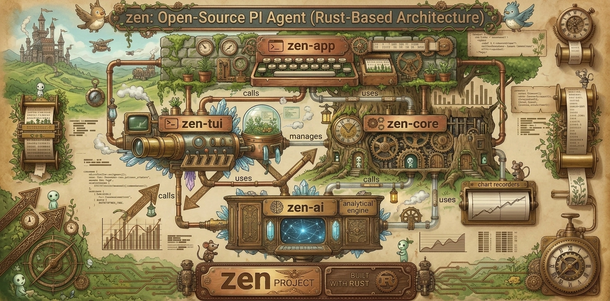

# Zen

<p align="center">
  
</p>

**A coding agent for your terminal, written in Rust.**

Zen is a from-scratch Rust reimplementation of [Pi](https://github.com/earendil-works/pi)'s
behaviour: an LLM-driven coding assistant with file tools, a shell tool, a session tree,
and a chat-style terminal UI.


---

## Why this project exists

Zen is a **learning project**, and it says so up front. It is one developer's way of
understanding how a modern coding agent is actually built — by rebuilding a working one,
module by module, in a different language, and documenting every decision along the way.

That framing matters, because it shapes what this codebase is and is not:

- **It is not a transliteration.** TypeScript idioms do not have Rust equivalents, so the
  porting work is the interesting part: `AbortSignal` becomes `CancellationToken`; typebox
  schemas become `schemars` + runtime `jsonschema` validation; async generators become
  `eventsource-stream` fed by `reqwest`; a bespoke TypeScript TUI framework becomes
  `crossterm` plus hand-written rendering.
- **It is not an AI-generated wishlist.** Every module in this repository traces back to a
  numbered requirement, which traces back to a specific module of the original project,
  which traces back to a numbered implementation task. Features are not "vibe-coded" into
  existence; they are specified, implemented, and covered by tests before they are called
  done.
- **It is honest about scope.** Some capabilities were deliberately left out (see
  [Non-goals](#non-goals)); each omission is a recorded decision, not an oversight.

If you are here to learn how an agent harness works — streaming, tool calls, context
compaction, session trees, terminal rendering — the source is meant to be read.

## Project status

| | |
|---|---|
| Version | `0.1.0` (pre-release) |
| Scope | v1 feature-complete: non-interactive (`-p`) and interactive modes |
| Providers | any OpenAI-compatible endpoint; two ship preconfigured |
| Crates | 4 (`zen-ai`, `zen-core`, `zen-app`, `zen-tui`) |
| Tests | 2,722 passing (`zen-ai` 352 · `zen-core` 806 · `zen-app` 888 · `zen-tui` 676) |
| Platforms | macOS and Linux (Unix shells required for the `bash` tool) |
| MSRV | Rust 1.97 |

Interfaces may still change between `0.1.x` releases. The public API surface is the `zen`
binary; the library crates are `pub` but not yet stability-guaranteed.

## Design principles

1. **Behaviour fidelity over line-by-line similarity.** Where the original makes a decision
   (truncation thresholds, retry policy, message ordering), Zen reproduces the *behaviour*,
   not the syntax.
2. **Traceable code.** Every source file carries a header naming the requirement and the
   original module it derives from. There is no code in this repository that cannot be
   explained by "why is this here?".
3. **Seams are named, never silently dropped.** When a capability cannot survive the port
   as-is, the code records where it went: closed (consumer implemented), pending (consumer
   scheduled), or dropped with a written rationale.
4. **Errors are typed at library boundaries.** `thiserror` in `zen-ai`/`zen-core`/`zen-tui`,
   `anyhow` in the application layer. `unwrap()`/`expect()` are not used in library code.
5. **Everything long-running is cancellable.** LLM calls and tool executions take a
   `CancellationToken`, the Rust analogue of the original's `AbortSignal`.
6. **Tests are the specification.** Public items are documented and tested; behaviour
   changes land with the test that pins them.

## Installation

### Requirements

- Rust **1.97** or newer (`rustup` recommended)
- A POSIX-ish shell (`sh`, `bash`, or `zsh`) on the machine that runs the agent
- macOS or Linux

### From source

Zen ships as a single binary built from this workspace:

```bash
git clone https://github.com/yaduns/zen.git
cd zen
cargo build --release

./target/release/zen --version     # run it in place
```

To use it from anywhere, put the binary on your `PATH`:

```bash
install -m 755 target/release/zen ~/.local/bin/zen   # or any directory on $PATH
```

## Quick start

> **Protocol support:** this version speaks **OpenAI Chat Completions
> (`POST /v1/chat/completions`) only.** Endpoints that require a different protocol —
> Anthropic Messages, Google Generative Language, Bedrock's native SDK — are **not** supported yet,
> so do not spend time trying to point Zen at them directly. Put an OpenAI-compatible gateway in
> front (OpenRouter, LiteLLM, your own proxy) or use a provider that already speaks the protocol.

Within that constraint, Zen works with any endpoint that implements the protocol — a hosted API,
a gateway, or a model running on your own laptop. There is no account to create and no sign-in flow: you point Zen at a
URL and hand it a key.

Three steps, about five minutes.

**1. Tell Zen where your model lives** — `~/.zen/agent/models.json`:

```json
{
  "providers": {
    "my-endpoint": {
      "name": "My endpoint",
      "api": "openai-completions",
      "baseUrl": "https://api.example.com/v1",
      "apiKey": "$ZEN_LLM_API_KEY",
      "models": [
        {
          "id": "my-model",
          "contextWindow": 128000,
          "maxTokens": 8192
        }
      ]
    }
  }
}
```

**2. Export the key** that file references:

```bash
export ZEN_LLM_API_KEY="sk-..."
```

**3. Run it:**

```bash
zen --provider my-endpoint --model my-model -p "Explain what this repository does"
```

To stop passing the flags, make it the default in `~/.zen/agent/settings.json`:

```json
{ "defaultProvider": "my-endpoint", "defaultModel": "my-model" }
```

`defaultModel` must be one of the ids listed under that provider in `models.json`. If you skip
this file, keep passing `--provider`/`--model`; otherwise Zen continues to use the built-in
default provider — see [How the provider and model are chosen](#how-the-provider-and-model-are-chosen).

Then:

```bash
zen                                     # interactive session in the current directory
zen "Find all TODOs in src/"            # open the UI with an initial prompt
zen -p "Review @src/main.rs"            # one-shot, non-interactive
echo "Explain this file" | zen -p       # stdin is used as the prompt
```

That is the entire setup. The rest of this document explains the pieces in detail.

## Supported providers

**One protocol, many hosts.** Zen does not ship per-vendor SDKs: it speaks OpenAI Chat
Completions and nothing else in this version. Any service that exposes an OpenAI-compatible
`/v1/chat/completions` with tool calling is therefore usable, which in practice covers almost the
entire market — first-party APIs, aggregators, and local inference servers alike. Services with a
proprietary protocol need a compatible gateway in front of them.

| Provider family | Examples | How to connect |
|---|---|---|
| First-party APIs | OpenAI, Azure OpenAI, Mistral, xAI, DeepSeek, Moonshot / Kimi, Zhipu GLM, Qwen / DashScope | `baseUrl` + API key |
| Aggregators and gateways | OpenRouter, Together AI, Fireworks, Groq, Cerebras, Perplexity, LiteLLM, Cloudflare AI Gateway | `baseUrl` + API key |
| Self-hosted / local | Ollama, LM Studio, llama.cpp (`llama-server`), vLLM, TGI, SGLang, LocalAI | `baseUrl` (typically `http://localhost:<port>/v1`), usually no key |
| Anything else | your own proxy, an internal gateway, a private vLLM cluster | `baseUrl` + optional custom `headers` |

Two providers ship preconfigured in the embedded catalog so a fresh install has sensible
defaults (OpenCode Go and Volcengine Ark). The catalog is **data, not code**: adding a
provider is a JSON entry, no rebuild required, and a user `models.json` is merged over the
built-in one at startup.

Provider quirks — reasoning/thinking payload shapes, tool-call encodings, streaming delta
formats, cache-usage fields — are handled by per-provider `compat` flags rather than by
branching inside the agent loop:

```json
"compat": { "thinkingFormat": "deepseek" }
```

If a provider deviates, the fix is a catalog entry, not a code change in the harness.

## Architecture

Zen is layered, and the dependency arrows only ever point down:

```
┌───────────────────────────────────────────────────────────────┐
│  zen-app                                                      │
│  CLI · print & interactive modes · session lifecycle ·        │
│  settings.json · keybindings.json · slash commands ·          │
│  resource loading · diagnostics                               │
├───────────────────────────────────────────────────────────────┤
│  zen-tui                     zen-core                         │
│  terminal, screen, editor,   agent loop · tools (read,        │
│  markdown, highlighting,     bash, write, edit, grep, find,   │
│  autocomplete, themes        ls) · compaction · skills ·      │
│                              session tree · exec env          │
├───────────────────────────────────────────────────────────────┤
│  zen-ai                                                       │
│  core types · model catalog (models.json) · streaming         │
│  OpenAI-compatible transport · tool abstraction · schema      │
└───────────────────────────────────────────────────────────────┘
```

Configuration splits along the same seam, and that split is deliberate:

- **`models.json` is catalog data, owned by `zen-ai`.** Embedded defaults overridden by the user
  file, which `zen-app` installs once at startup. `zen-core` can query the catalog without knowing
  anything about user preferences.
- **`settings.json` is application policy, owned by `zen-app`.** Defaults, shell, theme, compaction
  budget, keybindings — things the engine must not care about.

| Surface | Read by | Layer | Scopes |
|---|---|---|---|
| `models.json` | `zen-ai::catalog`, installed by `zen-app::config::catalog` | zen-ai | global |
| `settings.json` | `zen-app::config::settings` | zen-app | global ← project |
| `keybindings.json` | `zen-app::keybindings` | zen-app | global |
| `skills/`, `prompts/`, `themes/` | `zen-app::resources` | zen-app | global ← project |
| `AGENTS.md` / `CLAUDE.md` | `zen-app::resources` | zen-app | project root |
| `SYSTEM.md`, `APPEND_SYSTEM.md` | `zen-app::resources` | zen-app | project `.zen/` ← global |
| `sessions/*.jsonl` | `zen-app::session` | zen-app | global, or `--session-dir` |

"global" means `~/.zen/agent/` (relocatable with `ZEN_CODING_AGENT_DIR`), "project" means a
`.zen/` directory inside the repository you run Zen from. The project scope overrides the global
one per key, which is how a repository can pin its own model or theme.

A single turn flows like this:

```
prompt ──▶ zen-core::harness (context assembly: system prompt + history + compaction)
       ──▶ zen-ai (streaming chat completion over SSE)
       ──▶ tool calls (validated against JSON Schema) ──▶ zen-core::tools
       ──▶ results appended ──▶ repeat until the model stops asking for tools
       ──▶ events rendered by zen-tui (interactive) or emitted as text/JSON (print mode)
```

Session state is a **tree**, not a list: every message is a node, and `/fork`, `/clone`,
`/tree` and `--fork` operate on it directly. Sessions are persisted as append-only JSONL
(one record per line), which keeps history diffable, crash-tolerant, and easy to inspect
with standard Unix tools.

## Workflow

Zen assembles itself in a fixed order. Understanding this pipeline explains most of the
configuration behaviour later in this document — and most "why did it not pick my provider?"
questions.

```
   main()
     │
 1   ├─ parse CLI (clap)                        fast paths: --version, --export, --help
     │
 2   ├─ install the model catalog                embedded models.json  ←  ~/.zen/agent/models.json
     │
 3   ├─ resolve the mode                         --mode > -p > stdin is not a TTY > interactive
     │
 4   ├─ migrate legacy data                      session relocation, renamed keys (idempotent)
     │                                          └─ interactive only: first-run theme picker
 5   ├─ read stdin + expand @file arguments      MIME sniffing, images → base64 parts
     │
 6   ├─ choose the session                       --continue | --resume | --session | --session-id | --fork
     │                                          └─ session cwd guard (print: exit 1, interactive: prompt)
     │
     ├─────────── create_initial_runtime_from_cli ───────────
     │
 7   │  ├─ load settings                         ~/.zen/agent/settings.json  ←  ./.zen/settings.json
 8   │  ├─ resolve model + thinking level        CLI > resumed session > settings > env / built-in default
     │  │                                        └─ warn on model-not-in-catalog / missing API key
 9   │  ├─ load resources                        skills · prompt templates · themes · AGENTS.md · SYSTEM.md
10   │  ├─ assemble tools                        --tools / --exclude-tools / --no-tools selection
11   │  ├─ build the system prompt               base prompt + project context + append overrides
12   │  ├─ bind the wire protocol                stream_for(model.api) — the one seam where a protocol plugs in
13   │  └─ construct the runtime                 AgentSessionServices + Agent + compaction + cancellation token
     │
14   └─ dispatch                                  print (text / JSON, exit code)  |  interactive (TUI loop)
```

Two properties are worth calling out:

- **Failure is staged.** Anything that only matters to an interactive session (the first-run theme
  picker, the missing-session-cwd prompt) is skipped in print mode, which is why `zen -p` works
  unattended in scripts and CI.
- **`models.json` is loaded before settings, and both before the model is resolved.** That ordering
  is the reason a provider added to `models.json` immediately becomes addressable via
  `--provider`, and the reason a `defaultProvider` that no longer exists is caught (and reported)
  before the first request instead of after it.

## Crate structure

| Crate | Responsibility | Depends on |
|---|---|---|
| **`zen-ai`** | Model/provider abstractions, the `models.json` catalog, streaming transport for OpenAI-compatible endpoints, tool trait and schema validation, token accounting | — |
| **`zen-core`** | Provider-agnostic agent engine: harness/step loop, built-in tools, context compaction, skills, prompt templates, session tree, execution environment, path/MIME/ANSI/truncation utilities | `zen-ai` |
| **`zen-tui`** | Terminal layer: raw-mode handling, screen buffer, chat rendering, Markdown, syntax highlighting, editor and autocomplete widgets, themes | `zen-ai`, `zen-core` |
| **`zen-app`** | The `zen` binary: CLI parsing, mode dispatch (print/interactive), session manager, settings, slash commands, resource loading, observability | `zen-ai`, `zen-core`, `zen-tui` |

The split exists to keep the agent engine testable without a terminal and the terminal
testable without a model. `zen-core` never touches a TTY; `zen-tui` never touches the
network.

## Feature comparison with Pi

Legend: **Yes** = implemented · **Partial** = implemented with a documented subset ·
**No** = deliberately out of scope for v1.

| Capability | Pi (TypeScript) | Zen (Rust) | Notes |
|---|---|---|---|
| Non-interactive mode (`-p`, text/JSON output) | Yes | Yes | `--mode text\|json`; JSON emits one event per line |
| Interactive TUI | Yes | Yes | Hand-written on `crossterm` (no `ratatui`) |
| Streaming responses | Yes | Yes | SSE via `eventsource-stream` |
| Built-in tools | `read` `bash` `edit` `write` `grep` `find` `ls` | Same seven | Provider-agnostic `Tool` trait + JSON Schema validation |
| Session tree (fork / clone / navigate) | Yes | Yes | JSONL persistence |
| Session resume / continue | Yes | Yes | `--continue`, `--resume`, `--session`, `--session-id` |
| Context compaction | Yes | Yes | Token-budgeted, with configurable reserve/keep-recent |
| Skills | Yes | Yes | `SKILL.md` discovery + `/skill:<name>` expansion |
| Prompt templates | Yes | Yes | Frontmatter + `$ARGUMENTS` expansion |
| Themes | Yes | Yes | JSON themes, hot reload |
| Markdown rendering | Yes | Yes | `pulldown-cmark` |
| Syntax highlighting | Yes (highlight.js) | Yes (syntect) | Pure-Rust regex engine (no oniguruma) |
| `@file` attachments (incl. images) | Yes | Yes | MIME sniffing, base64 image parts |
| Model catalog | Yes (`model-config`) | Yes (`models.json`) | Any OpenAI-compatible endpoint without code changes |
| Custom system prompt / append | Yes | Yes | `--system-prompt`, `--append-system-prompt` |
| Thinking levels | Yes | Yes | `off` … `max`, 7 levels |
| Retry + backoff | Yes | Yes | Configurable attempts, base/max delay, timeouts |
| Configurable keybindings | Yes | Yes | User overrides in `keybindings.json` |
| Local diagnostics | Yes | Yes | `tracing` spans, per-step timing, `<agent-dir>/zen-debug.log`; `RUST_LOG` sets verbosity |
| **RPC / server mode** | Yes | **No** | No daemon, no socket, no remote API |
| **Extension / plugin system** | Yes | **No** | v1 ships no third-party extension surface |
| **Multi-protocol SDKs** (Anthropic, Google, …) | Yes | **No** | v1 is OpenAI Chat Completions only; the `Api` enum and stream-binding table leave room |
| **OAuth / `auth.json` login flows** | Yes | **No** | Credentials come from env vars or `models.json` |
| **SQLite session storage** | Optional | **No** | JSONL only |
| **Session HTML export** | Yes | **No** | `--export` is parsed but not implemented |
| **`share` / `login` / `logout` / `trust` / `import`** | Yes | **No** | Discarded with the server/extension removal |
| **Image generation** | Yes | **No** | Out of scope |
| **Telemetry / analytics (phone-home)** | — | **No** | No analytics, no crash reporting; traffic goes only to your configured endpoint |

## Configuration

Two scopes, one layout. Everything global lives under the agent directory (`~/.zen/agent` by
default, relocatable via `ZEN_CODING_AGENT_DIR`):

```
~/.zen/agent/                 # global scope
├── settings.json     # user preferences (partial; missing keys fall back to defaults)
├── models.json       # providers, endpoints, credentials, model definitions
├── keybindings.json  # optional user keybinding overrides
├── SYSTEM.md         # optional global system prompt
├── sessions/         # JSONL session files
├── skills/           # user-level SKILL.md packages
├── prompts/          # user-level prompt templates
├── themes/           # user-level JSON themes
└── ...
```

A repository can override the same surfaces next to its own code, which is handy for pinning a
model or theme per project:

```
<your-repo>/                  # project scope (wins over global, key by key)
├── AGENTS.md         # project instructions, injected into the system prompt
└── .zen/
    ├── settings.json
    ├── SYSTEM.md
    ├── skills/
    ├── prompts/
    └── themes/
```

### Environment variables

| Variable | Purpose |
|---|---|
| `ZEN_CODING_AGENT_DIR` | Override the agent directory (default `~/.zen/agent`) |
| `ZEN_CODING_AGENT_SESSION_DIR` | Override session storage (overridden by `--session-dir`) |
| `ZEN_PROVIDER` | Default provider name (equivalent to `--provider`) |
| `RUST_LOG` | Diagnostic verbosity, e.g. `RUST_LOG=debug zen` |

There are no provider-specific variables to memorise: Zen reads whatever environment
variable your `models.json` `apiKey` field points at (`"apiKey": "$ZEN_LLM_API_KEY"` means
`export ZEN_LLM_API_KEY=...`).

### How the provider and model are chosen

Zen resolves the pair once at startup; the first source that says anything wins:

| Priority | Source | Example |
|---|---|---|
| 1 | CLI flags | `zen --provider my-endpoint --model my-model` |
| 2 | The session being resumed | the model recorded in that session's JSONL |
| 3 | `settings.json` | `defaultProvider` / `defaultModel` |
| 4 | Environment, then built-in default | `ZEN_PROVIDER`, otherwise the catalog's default provider |

What that means in practice:

- **`settings.json` is optional but not redundant.** Adding a provider to `models.json` does not
  make it the default. Without `defaultProvider`/`--provider` you stay on the built-in default
  provider, whose key you probably do not have — the most common first-run surprise.
- **`defaultModel` must exist in that provider's `models` list.** Zen warns at startup when the
  resolved model is not declared in the catalog, and when no API key can be resolved for its
  provider, instead of letting it surface later as an opaque HTTP error.
- **A stale `defaultProvider` is ignored, not fatal.** Zen prints the provider names it does know
  and keeps the previous default, so a typo never blocks startup.
- **Settings are layered.** `~/.zen/agent/settings.json` is global; a `./.zen/settings.json` in the
  project you run from overrides it, which is convenient for per-repository model choices.

### `models.json`

Providers, base URLs, credentials, and model definitions are data, not code. Every
`/v1/chat/completions` endpoint you use — hosted, aggregated, or local — is one entry:

```json
{
  "providers": {
    "my-endpoint": {
      "name": "My OpenAI-compatible endpoint",
      "api": "openai-completions",
      "baseUrl": "https://api.example.com/v1",
      "apiKey": "$ZEN_LLM_API_KEY",
      "headers": { "x-custom-header": "value" },
      "compat": { "thinkingFormat": "openai" },
      "models": [
        {
          "id": "my-model",
          "reasoning": true,
          "contextWindow": 128000,
          "maxTokens": 8192,
          "cost": { "input": 0.5, "output": 2.0 }
        }
      ]
    }
  }
}
```

Local runtimes work the same way — point `baseUrl` at the server:

```json
{
  "providers": {
    "local": {
      "api": "openai-completions",
      "baseUrl": "http://localhost:11434/v1",
      "apiKey": "local",
      "models": [{ "id": "qwen3-coder:30b", "contextWindow": 262144 }]
    }
  }
}
```

`apiKey` is a **placeholder** here on purpose: Zen always sends an `Authorization: Bearer`
header, so keyless endpoints still need a value (any string works; a literal like `"local"` is
fine). Leaving it out produces a startup warning and `NoApiKey` on the first request.

`apiKey` values may reference environment variables with a `$NAME` prefix. A user
`models.json` is merged over the embedded catalog; an invalid file produces a warning and
falls back to the built-in catalog rather than preventing startup.

### `settings.json`

Every key is optional; unspecified keys use defaults.

```json
{
  "defaultProvider": "my-endpoint",
  "defaultModel": "my-model",
  "defaultThinkingLevel": "medium",
  "theme": "dark",
  "quietStartup": false,
  "shellPath": "/bin/zsh",
  "hideThinkingBlock": false,
  "compaction": {
    "enabled": true,
    "reserveTokens": 16384,
    "keepRecentTokens": 32768
  }
}
```

## Usage

### Interactive mode

```bash
zen                          # start a fresh session in the current directory
zen --continue               # resume the most recent session
zen --resume                 # pick a session from a list
zen --fork <session-id>      # branch a new session from an existing one
zen --name "refactor auth" "Help me split this module"
```

### Non-interactive mode

```bash
zen -p "List all Rust files that define a Tool impl"
zen --mode json -p "Summarise src/" | jq -r 'select(.type=="message")'
echo "Explain this file" | zen -p
zen -p "Review the code" @src/main.rs
```

`@path` arguments attach files to the prompt (images are detected and sent as image parts).

### Choosing a provider and model

```bash
zen --provider my-endpoint --model my-model     # one-off override
zen --list-models                                # browse the catalog
zen --list-models qwen                           # fuzzy search the catalog
```

Anything in the catalog (embedded + your `models.json`) is addressable this way; set
`defaultProvider`/`defaultModel` in `settings.json` to avoid repeating the flags.

### Tool selection

```bash
zen --tools read,grep -p "Find every TODO in src/"
zen --exclude-tools bash
zen --no-tools
```

Built-in tools: `read`, `bash`, `write`, `edit`, `grep`, `find`, `ls`.

### Keyboard shortcuts (interactive)

`/hotkeys` shows the live table, including your overrides. The defaults, verified against this
build:

**Chat and session**

| Keys | Action |
|---|---|
| `Enter` | Send the message |
| `Shift+Enter` · `Ctrl+J` | Insert a newline instead of sending (a trailing `\` + `Enter` also works where the terminal cannot report Shift+Enter) |
| `Esc` | Abort the running turn (when idle: start the double-press window) |
| `Esc` `Esc` | Open the session tree, or fork — chosen by `doubleEscapeAction` (`fork` · `tree` · `none`, default `tree`) |
| `Ctrl+C` | Clear the editor; press twice within 500 ms to exit |
| `Ctrl+D` | Exit (when the editor is empty) |
| `Ctrl+P` · `Shift+Ctrl+P` | Cycle to the next / previous model (blocked while a turn is running) |
| `Ctrl+L` | Open the model selector |
| `Shift+Tab` | Cycle the thinking level |
| `Ctrl+T` | Expand or collapse thinking blocks |
| `Ctrl+O` | Expand or collapse tool output |
| `Alt+Enter` | Queue the editor content as a follow-up message |
| `Alt+Up` | Take the most recently queued follow-up back into the editor |

**Editing the prompt**

| Keys | Action |
|---|---|
| `Ctrl+A` / `Home` · `Ctrl+E` / `End` | Move to line start / line end |
| `Alt+←` · `Alt+→` (also `Alt+B` / `Alt+F`) | Move by word |
| `Ctrl+W` · `Alt+Backspace` | Delete the previous word |
| `Alt+D` | Delete the next word |
| `Ctrl+U` · `Ctrl+K` | Delete to line start / line end |
| `Ctrl+Y` · `Alt+Y` | Yank the last kill / walk back through the kill ring |
| `Ctrl+-` | Undo |
| `Tab` | Accept the autocomplete suggestion |

**Inside a selector** (`/model`, `/resume`, `/settings`, `/tree`, `/scoped-models`)

| Keys | Action |
|---|---|
| `↑` `↓` | Move the selection |
| `Enter` | Confirm |
| `Esc` · `Ctrl+C` | Cancel |

Bindings are rebindable in `~/.zen/agent/keybindings.json`, addressed by action id: `app.*` for
session actions (e.g. `"app.interrupt"`), `tui.editor.*` for prompt editing
(`"tui.editor.deleteWordBackward"`), `tui.select.*` for menus. Unknown ids and unparseable keys
are reported at startup and the default is kept, so a broken file never leaves you without a
working keyboard.

> **Not wired yet.** Three bindings exist in the table but do nothing in this version, because they
> need platform clipboard access or an extra input mode: clipboard copy (`Ctrl+X`, reports "not
> available in v1"), image paste (`Ctrl+V`, unbound), and character jump (`Ctrl+]`). Kill/yank and
> queue restore, which need neither, are implemented.

### Slash commands (interactive)

| Command | Purpose |
|---|---|
| `/settings` | Open the settings menu |
| `/model` | Select a model (also cycles with `Ctrl+P`) |
| `/scoped-models` | Choose which models `Ctrl+P` cycles through |
| `/name` | Set the session display name |
| `/session` | Show session info and token statistics |
| `/hotkeys` | Show keybindings |
| `/fork` · `/clone` · `/tree` | Branch, duplicate, or navigate the session tree |
| `/new` | Start a new session |
| `/compact` | Compact the conversation context now |
| `/resume` | Switch to another session |
| `/quit` | Exit |

Skills are invocable as `/skill:<name>`.

## Development

```bash
cargo fmt --check
cargo clippy --all-targets -- -D warnings
cargo test --workspace
```

All three gates are required to pass before a change is considered complete.

### Repository layout

```
crates/
├── zen-ai/     model + transport + tool abstraction
├── zen-core/   agent engine, tools, sessions, compaction
├── zen-tui/    terminal rendering and widgets
└── zen-app/    the `zen` binary
```

### Examples

`crates/zen-app/examples/` holds one runnable program per CLI capability — useful both as
documentation of the public API and as a way to try a flag without touching your real sessions:

```bash
cargo run -p zen-app --example <name> -- [args]
```

| Example | Demonstrates | Needs a model endpoint |
|---|---|---|
| `quickstart` | The minimal pipeline: pick a model → bind the protocol → `create_agent_session` → one real turn | Yes |
| `example_provider` | `--provider`: resolve a provider by name | Yes |
| `example_model` | `--model`: override the model id | Yes |
| `example_thinking` | `--thinking`: set the reasoning level | Yes |
| `example_tools` | `--tools` / `--exclude-tools` / `--no-tools` / `--no-builtin-tools` | Yes |
| `example_system_prompt` | `--system-prompt`: replace the base prompt | Yes |
| `example_append_system_prompt` | `--append-system-prompt`: extend the base prompt | Yes |
| `example_skills` | `--skills <dir>`: load a skills directory into the system prompt | Yes |
| `example_no_session` | `--no-session`: ephemeral session, nothing persisted | Yes |
| `example_session_dir` | `--session-dir <dir>`: choose where sessions are stored | Yes |
| `example_resume` | `--resume` / `--continue`: restore the latest session and keep its history | Yes |
| `example_fork` | `--fork <source>`: branch from an existing session and keep its history | Yes |
| `example_no_context_files` | `--no-context-files`: skip `AGENTS.md`/`CLAUDE.md` discovery | No |
| `example_mode_json` | `--mode json`: one JSON event per line in print mode | No |
| `example_list_models` | `--list-models`: print the provider → model mapping | No |
| `example_version` | `--version` fast path | No |

The four marked **No** run without any credentials. The rest perform a real model call: configure a
provider in `models.json` first (see [Quick start](#quick-start)) — they fail loudly with the
endpoint's error rather than exiting silently.

### Debug vs release builds

Startup is not where the difference is: the optimised binary starts marginally *faster* and is a
third of the size. The real difference is iteration speed.

| | Debug (`cargo run`) | Release (`cargo build --release`) |
|---|---|---|
| Incremental rebuild | seconds | tens of seconds to minutes |
| Binary size | ~61 MB | ~17 MB |
| `--version` startup (Apple-silicon Mac) | ~6 ms | ~5 ms |

So iterate with debug builds and ship release builds. Both modes are the same binary:

| What you want | Command |
|---|---|
| Interactive TUI (chat, keybindings, session tree) | `cargo run -p zen-app --` |
| One-shot answer, non-interactive | `cargo run -p zen-app -- -p "Explain src/main.rs"` |
| JSON event stream (scripting) | `cargo run -p zen-app -- --mode json -p "Summarise src/"` |
| Prompt piped on stdin | `echo "Explain this file" \| cargo run -p zen-app -- -p` |
| Ship it | `cargo build --release` |

The TUI needs a real terminal: when stdin is a pipe or a redirect, Zen switches to print mode
on its own, so the first row only does what you expect when run in an actual terminal emulator.

If `cargo run` feels slower than the installed binary, it is the rebuild step, not the program.

### Adding a provider or model

No code changes are required. Add an entry to `models.json` (or send a PR against
[`crates/zen-ai/assets/models.json`](crates/zen-ai/assets/models.json) to extend the
embedded catalog). Supporting a *new wire protocol*, by contrast, means adding a variant to
the `Api` enum and a line in the stream-binding table — the architecture is designed so that
is a small, local change.

### Conventions

- Library code returns typed errors (`thiserror`); only the application layer uses `anyhow`.
- `unwrap()`/`expect()` are not allowed outside tests and a handful of annotated
  debug/assertion paths.
- Every `pub` item has a doc comment explaining intent and edge cases.
- Every behaviour change comes with a test.
- Long-running operations accept a `CancellationToken` and stop promptly when it fires.

### Change lifecycle

Nothing lands here without a specification behind it:

| Stage | Artifact | Question it answers |
|---|---|---|
| 1. Requirement | numbered requirement record | What behaviour is wanted, where it comes from, what is deliberately left out |
| 2. Task breakdown | numbered implementation note | Which files and signatures change; which upstream behaviour is preserved, transformed, or dropped |
| 3. Implementation | code under `crates/` | The change itself, with doc comments on every public item |
| 4. Verification | unit and integration tests | The pinned behaviour, including the edge cases the port had to keep |
| 5. Gates | `cargo fmt`, `cargo clippy`, `cargo test` | That the change is mergeable |
| 6. Commit | one commit per task | A history where each change maps back to a requirement |

Each task also declares the **seams** it creates or consumes — an interface another task is
expected to implement next. A seam is either closed (consumer landed), pending (consumer
scheduled), or explicitly dropped with a written reason, so an unfinished chain stays visible
instead of being discovered months later by a reader of the code.

### Where the design record lives

This repository is the **code snapshot**. Stages 1 and 2 — requirement records, task
breakdowns, seam notes and the audit trail that keeps them consistent — live in the development
repository and are not published here: they are process material rather than shipping code, and
they reference internal task identifiers that would only add noise to this tree.

### How this snapshot is produced

This tree is **generated**, not hand-merged: the development repository is cloned, process-only
paths (design docs, task notes, agent tooling, local scripts) are filtered out, code comments and
user-facing strings are normalised, and this README plus the license are injected as the final
commit. History here is therefore a rewritten, path-filtered projection of the development
history — linear, and containing exactly the shippable crates.

One consequence worth stating: test fixtures that exist *because* the code must handle CJK
wide-character, grapheme, and byte-boundary behaviour are kept in their original form. They are
test data, not documentation.

## Non-goals

These are explicit decisions, not gaps in the backlog:

- **No RPC/server mode.** Zen is a local, single-process CLI. There is no daemon to
  connect to.
- **No extension/plugin system.** v1 exposes no third-party extension surface; the tool
  trait is the intended integration point for embedders.
- **No multi-protocol SDK zoo.** v1 speaks OpenAI Chat Completions. Anthropic/Google
  transports are architecturally anticipated, not implemented.
- **No credential brokerage.** No OAuth, no token refresh, no shared credential store —
  API keys come from the environment or `models.json`.

## Roadmap

- [x] **v0.1** — print mode, interactive TUI, session tree, compaction, skills, themes,
      `models.json`-driven catalog
- [ ] **Harness framework support** — a first-class harness layer for composing, running and
      evaluating agent workflows, with pluggable tools, prompts and execution policies that go
      beyond a single interactive session
- [ ] **First-class Rust project support** — cargo/workspace-aware context (crate graph, target
      layout, feature flags), a `cargo` tool integration, and compiler/`clippy` diagnostics fed
      back into the tool loop so the agent can compile, test, and fix its own changes

## Contributing

Issues and pull requests are welcome. Please:

1. Open an issue describing the behaviour you want to change before large PRs.
2. Keep commits scoped and prefixed with the area they touch.
3. Include tests; a change without a test is treated as incomplete.
4. Make sure `cargo fmt --check`, `cargo clippy --all-targets -- -D warnings`, and
   `cargo test --workspace` pass.

## License

MIT — see [LICENSE](LICENSE).

## Acknowledgements

Zen exists because [Pi](https://github.com/earendil-works/pi) exists. This project models its
behaviour on that agent and owes its architecture, prompt semantics, tool contract, and
session model to it. Any interesting design here is inherited; the Rust-specific design and
any mistakes are the author's own.
